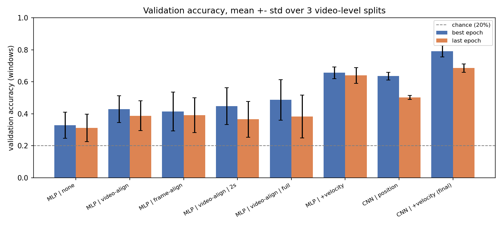
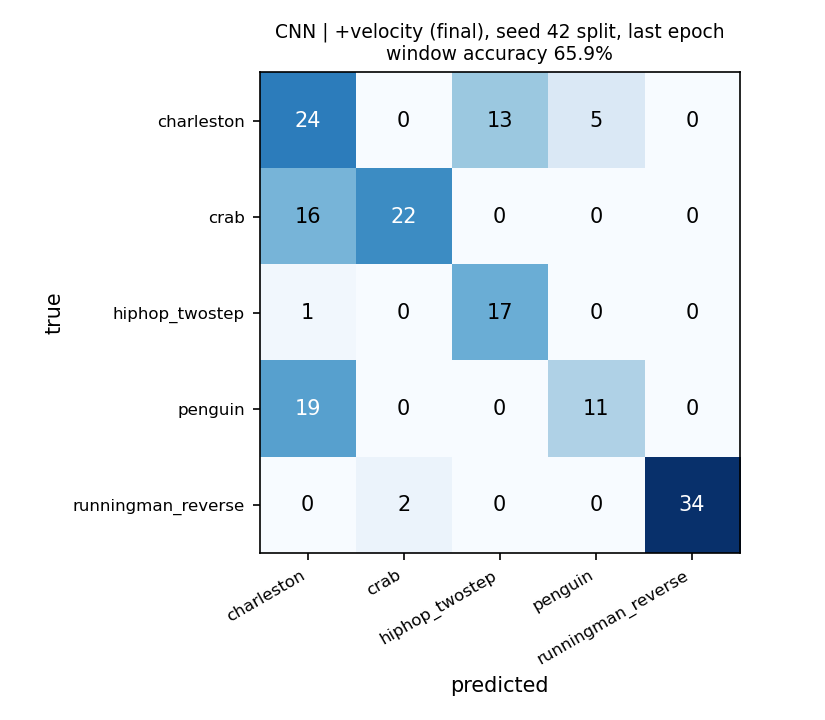
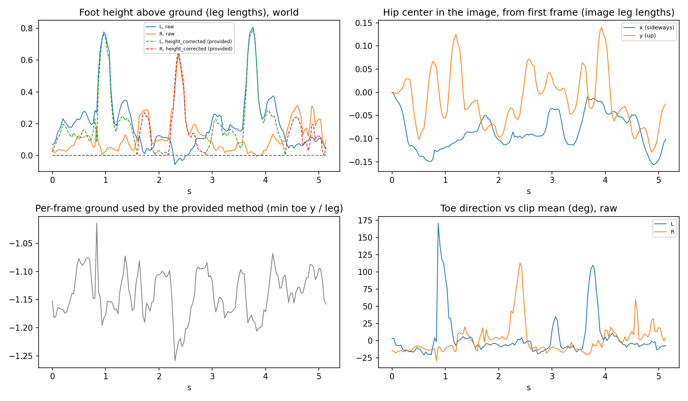

# 3D 관절 좌표 기반 K-pop 기본 스텝 분류: 중간 보고서

MediaPipe BlazePose 3D 관절 좌표로 K-pop 기본 스텝 5가지를 분류하는 PyTorch 모델을 만든 과정을 정리했다.
채점 4영역(데이터셋 / 모델과 실험 / 분석과 시각화 / 재현성) 순서로 쓰고, 진행 중 생긴 문제와 해결 방법은 6장에 모았다.
`[채우기]` 표시는 작성자가 직접 채워야 하는 부분이다.

---

## 0. 최소 요건 점검

| 요건 | 상태 | 근거 |
|---|---|---|
| 라벨 3개 이상 | 충족 | 5개: crab, penguin, hiphop_twostep, charleston, runningman_reverse |
| 클래스당 영상 5개 이상 | 충족 | 클래스당 원본 8개 (+ 좌우반전 8개) |
| MediaPipe 3D 좌표 입력 | 충족 | `pose_world_landmarks` (미터 단위, 골반 중심 원점) |
| PyTorch 모델 | 충족 | MLP(기준), 1D CNN(최종) |
| 학습에 안 쓴 영상으로 테스트 | **미완** | 지금 수치는 검증(validation) 영상 기준. 다른 사람이 춘 테스트 영상이 필요 |
| 데모 영상(1~3분), 틀린 예측 포함 | **미완** | 틀린 예측 후보: 7.3절 |

---

## 1. 데이터셋

### 1.1 라벨과 선정 이유

| 라벨 | 동작 요약 | 데이터에서 보이는 특징 (원본 40개, 스텝별 중앙값) |
|---|---|---|
| crab | 양발을 벌렸다 모으며 옆으로 이동 | 양발 높이 상관 **+0.66** (두 발이 함께 움직임, 나머지 스텝은 모두 음수) |
| penguin | 발끝을 바깥으로 돌리며 걷기 | 스텝 주기 약 1.5초 |
| hiphop_twostep | 좌우로 한 발씩 딛는 투스텝 | 양발이 둘 다 뜬 프레임 높이 0.177, 앞뒤 발 간격 0.55 |
| charleston | 한 발씩 앞뒤로 차기 | 양발이 둘 다 뜬 프레임 높이 0.156 |
| runningman_reverse | 제자리 뛰듯 발을 뒤로 끌기 | 앞뒤 발 간격 **0.65**(최대), 발끝 방향 변화 최대 |

선정 이유
- **하체 동작만으로 구분되는 스텝**을 골랐다. 입력을 하체 관절(골반, 무릎, 발목, 뒤꿈치, 발끝 10개)로 제한해도 라벨을 구분할 수 있어야 하고, 실제로 위 표처럼 발의 움직임 지표가 스텝마다 다르게 나타났다.
- 이름이 정해진 기본 스텝이라 사람마다 라벨 기준이 흔들리지 않는다. 초기안이던 Sharp/Smooth/Wave 같은 질감 라벨은 주관적이어서 버렸다.
- [채우기: 추가로 이 스텝들을 고른 개인적 이유가 있다면 작성]

### 1.2 수집

| 항목 | 내용 |
|---|---|
| 출처 | 인터넷 공개 영상 [채우기: 출처 / URL 목록] |
| 영상 수 | 스텝당 8개, 총 40개 (`data/raw_videos/<step>/<step>_<1-8>.mp4`) |
| 형식 | 1080x1920(세로), 30fps |
| 길이 | 2.7~7.7초. 스텝별 합계 35~43초로 클래스 간 균형이 맞음 |
| 포즈 검출률 | 40개 모두 100% 프레임 검출 |
| 증강 | 좌우반전 영상 40개 추가 (`p0_mirror_videos.py`, 9~16번) |

수집 방식 변경 기록
- 원래 계획은 직접 촬영(100 / 130 BPM 두 속도)이었으나, 인터넷 영상 수집으로 바꾸면서 BPM 구분을 없앴다. 템포를 통제할 수 없는 영상이라 BPM 라벨이 의미가 없기 때문이다.
- 인터넷 영상은 fps가 제각각일 수 있어 모든 영상을 30fps로 맞추는 단계를 넣었다(6장 문제 7).

---

## 2. 전처리와 입력 설계

### 2.1 파이프라인

```
p0_mirror_videos.py              영상 좌우반전 증강 + 원본-반전 짝 기록 (data/mirror_pairs.json)
p1_create_raw_keypoints.py       영상 -> MediaPipe 3D world 좌표 (+ 2D 이미지 좌표, fps) .npz
p1_3_analyze_postprocessing.py   Assignment 02: 후처리 전후 비교 지표 + 그래프
p2_create_dataset.py             특징 생성 -> 1초(30프레임) 조각, 영상 단위 train/val 분할
p3_train_mlp.py                  모델 학습 (MODEL_TYPE = "mlp" | "cnn")
p4_predict.py                    영상 1개 예측 (조각별 확률 평균)
p5_run_experiments.py            실험 표, 그래프, 혼동행렬 재생성
```

### 2.2 입력 특징 (`scripts/features.py`)

1. **30fps로 맞춤**: 30프레임 조각이 항상 약 1초가 되도록 한다.
2. **골반 중심 좌표**: 모든 관절에서 골반 중앙(23, 24번 평균)을 뺀다.
3. **카메라 각도 정렬** (`NORMALIZE = "video"`): 왼쪽 골반에서 오른쪽 골반으로 가는 방향의 영상 평균이 +x축이 되도록 수직(y)축 기준으로 회전하고, 다리 길이(골반 중앙에서 발목 중앙까지, 중앙값)로 나눈다.
4. **하체 관절 선택**: 23~32번, 10개 관절 x 3 = 프레임당 30개 값.
5. **속도 추가** (`VELOCITY = True`): 프레임 간 차이 x 30을 붙인다(초당 다리 길이 단위). 프레임당 60개 값.
6. **조각 나누기**: 30프레임 길이, 15프레임 간격. 모델 입력 크기는 (30, 60).

### 2.3 학습/검증 분할

- **영상 단위로 분할**한다. 같은 영상의 조각이 학습과 검증 양쪽에 들어가지 않는다.
- **원본과 반전본은 항상 같은 쪽에** 넣는다. 반전본은 사실상 같은 영상이라, 섞이면 검증 정확도가 부풀려진다.
- 스텝당 8개 원본 묶음 중 2개(20%)가 검증으로 간다. 분할 결과는 시드에 따라 달라지므로 시드 3개(1, 7, 42)로 반복했다.

---

## 3. 모델과 실험

### 3.1 모델

| 모델 | 구조 | 파라미터 |
|---|---|---|
| MLP (기준, 제공 코드) | Flatten -> 128 -> 64 -> 5 | 입력 (30x60) 기준 약 24만 |
| 1D CNN (최종) | Conv1d(60->64, k5) + BN + ReLU -> Conv1d(64->64, k5) + BN + ReLU -> 시간축 평균 -> Dropout 0.3 -> 5 | 약 4만 |

공통 설정: Adam, 학습률 0.001, 배치 16, 30 epoch, CrossEntropy.
1D CNN은 시간축을 따라 같은 필터를 미끄러뜨린다. 그래서 같은 발동작이 조각 안 어느 위치에 나와도 똑같이 잡아낸다.

### 3.2 결과 (`p5_run_experiments.py`, 검증 정확도, 1초 조각 기준, 시드 3개 평균 ± 표준편차)

| 실험 | 설정 | 최고 epoch | 마지막 epoch |
|---|---|---|---|
| 기준 | MLP, 정렬 없음, 위치만 | 32.8 ± 8.2% | 31.1 ± 8.5% |
| 실험 3: 전처리 | MLP, 영상 단위 정렬 | 42.8 ± 8.3% | 38.8 ± 9.3% |
| 실험 3: 전처리 | MLP, 프레임 단위 정렬 | 41.4 ± 12.1% | 39.1 ± 10.8% |
| 조각 길이 | MLP, 영상 정렬, 2초(60프레임) | 44.8 ± 11.5% | 36.5 ± 11.1% |
| 실험 2: 하체 vs 전신 | MLP, 영상 정렬, 전신 33관절 | 48.6 ± 12.6% | 38.2 ± 13.4% |
| 특징 | MLP, 영상 정렬, + 속도 | 65.6 ± 3.7% | 63.9 ± 4.9% |
| 실험 1: 모델 | 1D CNN, 위치만 | 63.5 ± 2.4% | 50.2 ± 1.2% |
| **실험 1: 모델 (최종)** | **1D CNN + 속도** | **79.0 ± 3.5%** | **68.5 ± 2.6%** |

찍기 수준은 20%(5클래스)다.
- **최고 epoch**: 30 epoch 중 검증 정확도가 가장 높았던 값이다. p3가 이 시점의 모델을 저장한다. 검증 데이터로 시점을 고르므로 낙관적인 값이다.
- **마지막 epoch**: 고르는 과정 없이 학습을 끝낸 시점의 값이다.



### 3.3 실험별 결론

- **실험 1 (모델)**: 같은 입력에서 1D CNN이 MLP보다 높다(위치만: 마지막 epoch 50% vs 39%, 속도 포함: 69% vs 64%). 시간 순서를 다루는 구조가 효과가 있다.
- **실험 2 (하체 vs 전신)**: 전신이 평균은 약간 높지만 표준편차가 커서(±13%) 차이가 의미 있다고 보기 어렵다. 마지막 epoch는 38% vs 39%로 같다. 하체만으로 충분하다는 원래 가설과 어긋나지 않는다.
- **실험 3 (전처리)**: 카메라 각도 정렬로 31% → 39%(마지막 epoch)가 됐다. 영상 단위와 프레임 단위 정렬은 차이가 없다.
- **속도 특징이 가장 큰 개선**이다(MLP 39% → 64%). 표준편차도 ±10%에서 ±5%로 줄어 분할에 덜 흔들린다. 스텝은 발의 위치보다 발이 움직이는 방식으로 구분된다는 해석이 가능하다.
- **2초 조각은 효과 없음**: 조각 수가 줄어(학습 488개 → 368개) 데이터 부족이 더 심해지는 것으로 보인다.
- 실험 4(100↔130 BPM 일반화)는 BPM 구분을 없애면서 진행하지 않았다.

---

## 4. 분석과 시각화

### 4.1 혼동행렬 (최종 모델, 시드 42 분할, 마지막 epoch)



- 조각 기준 65.9%, **영상 기준 70%**(20개 중 14개). 영상 기준은 영상 하나의 조각 확률을 평균해 판정한다(p4와 같은 방식).
- runningman_reverse(34/36)와 hiphop_twostep(17/18)은 거의 다 맞는다.
- **charleston으로 몰리는 오답**이 많다: crab → charleston 16, penguin → charleston 19. 또 charleston ↔ hiphop_twostep 혼동이 13이다.

### 4.2 영상 단위 오답 (`docs/figures/per_video.csv`)

| 영상 | 정답 | 예측 |
|---|---|---|
| crab_1, crab_9(반전) | crab | charleston |
| penguin_1, penguin_9(반전) | penguin | charleston |
| charleston_4, charleston_12(반전) | charleston | hiphop_twostep |

- 원본과 반전본의 예측이 항상 같다. 모델이 좌우 방향에는 흔들리지 않는다.
- 틀린 crab_1과 penguin_1은 둘 다 1번 영상이다. 1번 영상들은 몸 방향(골반 yaw)이 +87~+104°로, 대부분의 영상(-75~+4° 또는 -167~-140°)과 다르다. 카메라 각도가 다르면 정렬 후에도 깊이(z) 추정 자체가 달라질 수 있다. 다만 hiphop_twostep_6도 +117°인데 맞혔으므로, 각도만으로 오답을 설명할 수는 없다. 원인은 확인하지 않았다.
- 데모 영상의 틀린 예측 장면으로 이 영상들을 쓸 수 있다.

### 4.3 후처리 분석 (Assignment 02와 공유)

`p1_3_analyze_postprocessing.py`, 원본 40개 영상, 지표는 다리 길이로 정규화, 중앙값.

| 지표 | raw | 제공 후처리 (height corrected) | + Savitzky-Golay (보너스) |
|---|---|---|---|
| 양발이 둘 다 뜬 높이 p95 | 0.133 | **0.000** | 0.003 |
| 발 높이 p95 | 0.343 | 0.308 | 0.299 |
| 하체 떨림 (2차 차분 RMS) | 0.0204 | 0.0216 | **0.0072** |
| 발목 jerk RMS | 2241 | 2312 | **457** |
| 골반 높이 변화폭 | 0.001 | 0.133 | 0.126 |

- **MediaPipe world 좌표의 원점은 골반 중앙이다**: 40개 영상 모두 골반 중앙이 원점에서 최대 5mm 이내였다(문서 내용을 실제 데이터로 확인).
- **제공 후처리**는 매 프레임 가장 낮은 발끝 높이를 바닥(0)으로 맞춘다.
  - 그래서 양발이 모두 뜨는 순간(점프)도 한 발이 바닥으로 끌려 내려와, 그 지표가 0이 된다. 점프 정보가 사라진다.
  - 매 프레임 바닥 기준이 흔들려서 떨림은 오히려 6% 늘었다.
  - 골반 중심 좌표에서는 이 보정이 거의 상쇄된다. 모든 관절을 같은 만큼 위아래로 옮기는 것이기 때문이다(0 미만을 0으로 자르는 부분만 남는다). 그래서 모델 입력에는 쓰지 않았다.
- **Savitzky-Golay 평활화**(창 9, 3차)는 떨림을 67%, jerk를 80% 줄인다.
- 한계
  - 발을 들 때 발끝 방향(yaw) 값이 순간적으로 100° 이상 튄다. 발이 위를 향하면 수평면 방향이 불안정해지기 때문이다(아래 그림 오른쪽 아래).
  - charleston과 hiphop_twostep의 스텝 주기 추정값(0.23초)은 탐색 범위 하한이라 믿기 어렵다.



---

## 5. 재현성

```bash
conda env create -f environment.yml      # Python 3.10, mediapipe 0.10.21, torch 2.14.1 (CPU)
conda activate ai_ml_final
cd final_project

# 영상이 있을 때 (영상은 저작권 문제로 GitHub에 올리지 않음)
python scripts/p0_mirror_videos.py
python scripts/p1_create_raw_keypoints.py --local
python scripts/p1_3_analyze_postprocessing.py

# 영상 없이 여기서부터 재현 가능 (data/raw_keypoints/*.npz 80개가 저장소에 포함)
python scripts/p2_create_dataset.py
python scripts/p3_train_mlp.py
python scripts/p4_predict.py data/raw_keypoints/penguin/penguin_8.npz
python scripts/p5_run_experiments.py
```

- 고정한 시드: 분할 `SEED = 42`(p2), 학습 `torch.manual_seed(42)`(p3), 실험 시드 1, 7, 42(p5).
- 설정은 모두 코드 위쪽 상수에 있다: `FEATURE_SET`, `NORMALIZE`, `VELOCITY`(features.py), `MODEL_TYPE`(p3), `SEQ_LENGTH`, `STRIDE`(p2).
- 학습 때 쓴 특징 설정은 `data/dataset/feature_meta.json`, 모델 종류는 `checkpoints/model_meta.json`에 자동 기록된다. p4는 이 두 파일을 읽어서 학습 때와 똑같이 처리한다.
- 실행 환경: Windows 11, CPU. 한 번 학습하는 데 수십 초가 걸린다.

---

## 6. 문제와 해결 과정

| # | 문제 | 원인 | 해결 |
|---|---|---|---|
| 1 | 환경을 활성화하지 않고 실행하면 scipy가 0xc06d007f로 죽음 | conda 환경의 DLL 경로가 PATH에 없음 | Anaconda Prompt에서 `conda activate` 후 실행 |
| 2 | Windows 콘솔에서 출력하다 `UnicodeEncodeError` | 콘솔 인코딩이 cp949라 이모지나 특수기호를 못 씀 | 출력 문자를 ASCII로 변경 |
| 3 | `--local` 모드인데 pytubefix 없다고 실패 | YouTube 모드용 import가 파일 맨 위에 있음 | YouTube 함수 안으로 import를 옮김 |
| 4 | 영상이 바뀌어도 이전 영상의 추적 상태가 남음 | MediaPipe Pose 객체 하나를 모든 영상에 재사용 | 영상마다 새로 만들고 닫음 |
| 5 | 포즈가 하나도 안 잡힌 npz에서 p2가 죽음 | 빈 배열 처리가 없음 | 분할 전에 빈 파일을 제외하고 알림 |
| 6 | 발끝 방향 지표가 2884°처럼 폭주 | 각도 unwrap이 잡음에 누적됨 | 영상 평균 방향 기준 원형 차이로 계산 |
| 7 | 영상마다 fps가 다르면 1초 조각의 실제 길이가 달라짐 | 조각 길이를 프레임 수로 정함 | p1이 fps를 저장하고, p2/p4가 30fps로 리샘플 |
| 8 | 촬영 계획(BPM 2종)과 실제 데이터(인터넷 영상)가 어긋남 | 수집 방식 변경 | BPM 기준 분할 코드를 제거하고 영상 단위 무작위 분할로 단순화 |
| 9 | **첫 학습 검증 정확도 21%(찍기 수준)**, 거의 모든 예측이 runningman | 영상마다 몸 방향이 +100°, -15°, -160°로 달라 같은 스텝도 좌표가 회전돼 들어감 (혼동행렬과 영상별 골반 yaw로 확인) | 수직축 회전 정렬 + 다리 길이 스케일 정규화 → 31% → 39% |
| 10 | 데이터 부족 (스텝당 1초 조각 약 50개) | 영상이 3~7초로 짧음 | 좌우반전 증강으로 2배. 효과는 작았음(38% → 39%) |
| 11 | 반전본이 검증에 섞이면 정확도가 부풀려질 위험 | 원본과 반전본이 사실상 같은 영상 | `mirror_pairs.json`으로 짝을 기록하고 같은 쪽으로 분할 |
| 12 | 위치 정보만으로는 한계 | 스텝 차이는 발의 위치보다 움직임에 있음 | 속도 특징 추가(39% → 64%) + 1D CNN(→ 69%) |
| 13 | CNN의 최고 epoch와 마지막 epoch 차이가 큼 (79% vs 69%) | 검증 데이터가 적어 epoch마다 출렁임 | 두 값을 모두 보고. 최종 성능은 별도 테스트 세트로 잴 예정 |
| 14 | 5번 영상들의 발 가시성이 낮음 (80~100% 프레임이 0.5 미만) | [채우기: 영상 확인 결과, 예: 발이 화면 밖 / 화질] | 현재는 포함. 제외 실험은 미실시 |

---

## 7. 한계와 남은 작업

1. **테스트 세트 없음**: 지금 수치는 모두 검증 영상 기준이다. 다른 사람이 춘 영상을 스텝당 1개 이상 `data/test_videos/`에 넣고 p1 `--local --test` → p4로 평가해야 한다.
2. **데이터 다양성**: 클래스당 원본 8개, 출처 수가 적다. 반전 증강의 효과가 작았던 것을 보면 양보다 사람과 출처의 다양성이 부족하다.
3. **골반 중심 좌표의 정보 손실**: 크랩의 옆 이동과 점프 높이는 골반 중심 좌표에서 사라진다. p1이 2D 이미지 좌표를 함께 저장하므로 골반 이동량을 입력에 추가하는 실험이 가능하다.
4. **데모 영상**: 예측 결과를 영상 위에 겹친 1~3분 영상. 틀린 예측(4.2절)을 포함해야 한다.
5. LSTM은 시도하지 않았다(1D CNN으로 대체).
